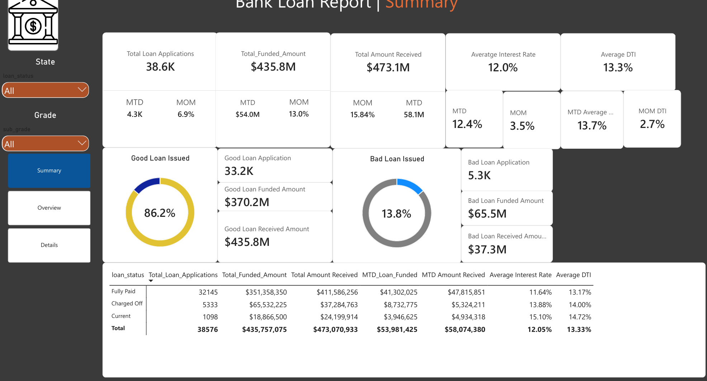
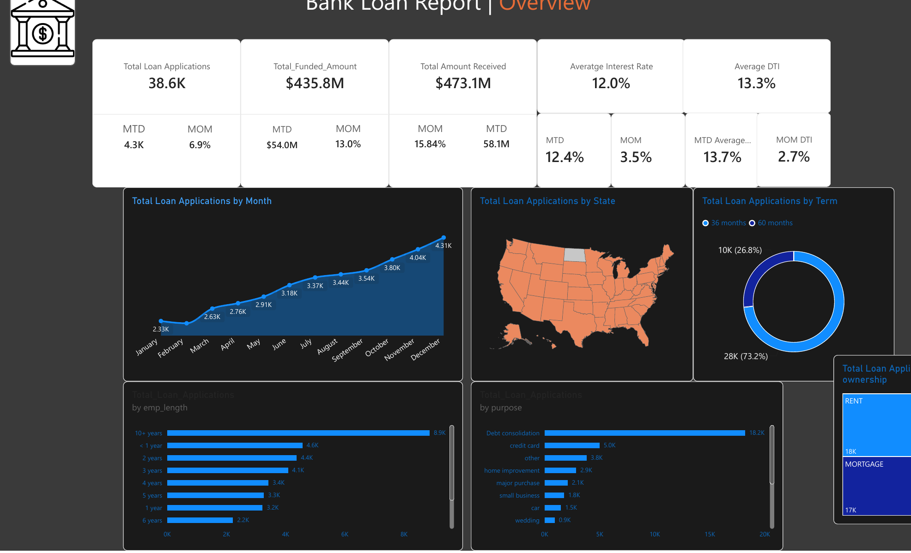
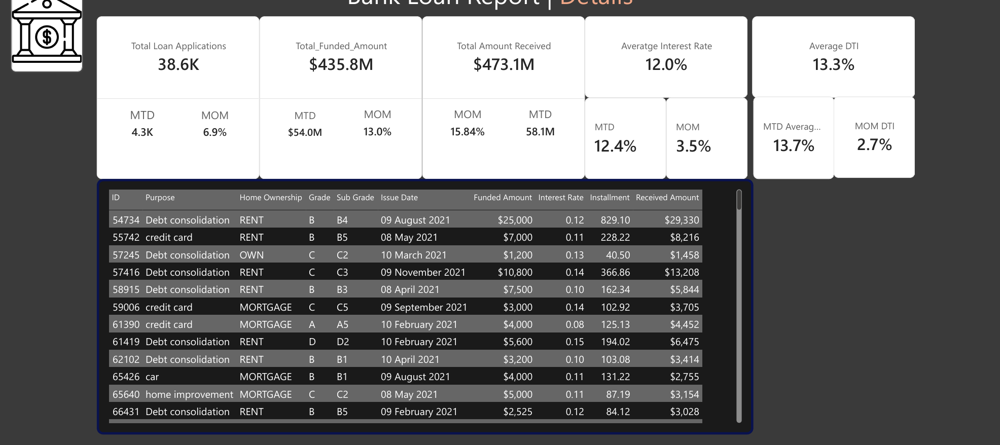

# Bank Loan Report (Power BI, DAX and Time Intelligence)

> A three-page Power BI report on 38,576 bank loan applications and $435.8M in funded loans. It tracks good and bad loans, interest rate and DTI, and month-to-date (MTD) and month-over-month (MOM) change.



## 🎯 Business Question

How is the loan book performing, and where is the risk? Specifically:

- How many applications came in, how much was funded and how much was received?
- What share of loans are good (Fully Paid or Current) and what share are bad (Charged Off)?
- How do applications, funding, interest rate and DTI change from month to month?
- Which purposes, states, terms, home-ownership types and employment lengths drive applications?

## 📁 Data Model

| Table | Role |
|---|---|
| `financial_loan` | Loan-level data: id, loan_status, purpose, term, sub_grade, issue_date, loan_amount, int_rate, installment, total_payment |
| `Dim_Client Data` | Client attributes: emp_length, address_state, home_ownership, grade |
| `Calender_Table` | Date table used for the MTD and MOM measures |
| `_measures` | A dedicated table that holds all the DAX measures |

## 🛠️ Tools

Power BI Desktop · DAX · Data modeling

## 🧮 DAX Measures

All measures live in the `_measures` table.

**Core totals**

```dax
Total_Loan_Applications = DISTINCTCOUNT(financial_loan[id])
Total_Funded_Amount     = SUM(financial_loan[loan_amount])
Total Amount Received   = SUM(financial_loan[total_payment])
Average Interest Rate   = AVERAGE(financial_loan[int_rate])
Average DTI             = AVERAGE(financial_loan[dti])
```

**Month-to-date (MTD) and previous month-to-date (PMTD)**

```dax
MTD_Loan_Applications = CALCULATE([Total_Loan_Applications], DATESMTD(financial_loan[issue_date]))
MTD_Loan_Funded       = CALCULATE([Total_Funded_Amount], DATESMTD(financial_loan[issue_date]))
MTD Amount Recived    = CALCULATE([Total Amount Received], DATESMTD(financial_loan[issue_date]))
MTD Average Interest Rate = CALCULATE([Average Interest Rate], DATESMTD(financial_loan[issue_date]))
MTD Average DTI       = CALCULATE([Average DTI], DATESMTD(financial_loan[issue_date]))

PMTD Loan Applications = CALCULATE([Total_Loan_Applications],
    DATEADD(DATESMTD(Calender_Table2[Date].[Date]), -1, MONTH))
PMTD loan Funded       = CALCULATE([Total_Funded_Amount],
    DATEADD(DATESMTD(Calender_Table2[Date].[Date]), -1, MONTH))
PMTD Amount Recieved   = CALCULATE([Total Amount Received],
    DATEADD(DATESMTD(Calender_Table2[Date].[Date]), -1, MONTH))
PMTD Average Interest Rate = CALCULATE([Average Interest Rate],
    DATEADD(DATESMTD(Calender_Table2[Date].[Date]), -1, MONTH))
PMTD DTI               = CALCULATE([Average DTI],
    DATEADD(DATESMTD(Calender_Table2[Date].[Date]), -1, MONTH))
```

**Month-over-month (MOM) change**

```dax
Loan APP_MOM          = DIVIDE([MTD_Loan_Applications] - [PMTD Loan Applications], [PMTD Loan Applications])
Loan Funded_MOM%      = DIVIDE([MTD_Loan_Funded] - [PMTD loan Funded], [PMTD loan Funded])
Recieved Amount_MOM%  = DIVIDE([MTD Amount Recived] - [PMTD Amount Recieved], [PMTD Amount Recieved])
MOM Interest Rate     = DIVIDE([MTD Average Interest Rate] - [PMTD Average Interest Rate], [PMTD Average Interest Rate])
MOM DTI               = DIVIDE([MTD Average DTI] - [PMTD DTI], [PMTD DTI])
```

**Good loans (Fully Paid or Current) and bad loans (Charged Off)**

```dax
Good Loan Application = CALCULATE([Total_Loan_Applications],
    financial_loan[loan_status] IN { "Fully Paid", "Current" })
Good Loan App %       = DIVIDE([Good Loan Application], [Total_Loan_Applications], 0)
Good Loan Funded Amount   = CALCULATE(SUM(financial_loan[loan_amount]),
    financial_loan[loan_status] IN { "Fully Paid", "Current" })
Good Loan Received Amount = CALCULATE(SUM(financial_loan[total_payment]),
    financial_loan[loan_status] IN { "Fully Paid", "Current" })

Bad Loan Application = CALCULATE([Total_Loan_Applications],
    financial_loan[loan_status] IN { "Charged Off" })
Bad Loan %           = DIVIDE([Bad Loan Application], [Total_Loan_Applications], 0)
Bad Loan Funded Amount   = CALCULATE(SUM(financial_loan[loan_amount]),
    financial_loan[loan_status] IN { "Charged Off" })
Bad Loan Received Amount = CALCULATE(SUM(financial_loan[total_payment]),
    financial_loan[loan_status] IN { "Charged Off" })
```

**Also in the model** (not shown on the report pages): `SPL` (funded amount for the same period last year, using `SAMEPERIODLASTYEAR`) and `loansPM` (funded amount shifted back one month with `DATEADD`).

## 📑 Report Pages

1. **Summary:** KPI cards with MTD and MOM, good loan and bad loan donuts with their totals, and a table by loan status.
2. **Overview:** applications by month, by state (map), by term, by home ownership, by employment length and by purpose.
3. **Details:** a loan-level table (ID, purpose, home ownership, grade, sub grade, issue date, funded amount, interest rate, installment, received amount).

The Summary page has slicers for state and grade.



## 🔍 Key Findings

- **38,576 applications, $435.8M funded and $473.1M received.** Received is $37.3M (8.6%) above funded, which reflects the interest paid on top of principal.
- **86.2% of loans are good and 13.8% are bad.** That is 33.2K good applications ($370.2M funded) against 5.3K bad ones ($65.5M funded).
- **Good loans return more than they cost.** They received $435.8M on $370.2M funded (118%).
- **Charged-off loans recovered only 57%.** They received $37.3M on $65.5M funded, a shortfall of $28.2M.
- **Riskier loans carry higher rates.** Average interest rate is 13.88% for Charged Off loans and 11.64% for Fully Paid. Average DTI is 14.00% against 13.17%.
- **Applications grew steadily through the year**, from 2.33K in January to 4.31K in December (about 85% higher).
- **Debt consolidation is the top purpose** with 18.2K applications (47%), far ahead of credit card (5.0K).
- **Most loans are 36 months** (28K, 73.2%) against 10K (26.8%) for 60 months.
- **Renters and mortgage holders dominate home ownership** (about 18K and 17K).
- **Applicants with 10+ years of employment apply the most** (8.9K).
- **Latest month:** MTD applications are 4.3K (+6.9% MOM), MTD funded is $54.0M (+13.0% MOM), MTD average interest rate is 12.4% (+3.5% MOM) and MTD DTI is 13.7% (+2.7% MOM).



## ⚠️ Data Notes

- Total amount received ($473.1M) is higher than the funded amount, so it includes interest. It is not the same as principal repaid.
- The "Current" loans (1,098) are counted as good loans although they are not finished yet.
- The report shows no year on the monthly chart. The loan table has issue dates in 2021, so the monthly trend most likely covers that year.
- The MTD measures filter on `financial_loan[issue_date]`, while the PMTD measures use a second date table (`Calender_Table2`). Pointing both at the same date table would make the MOM figures easier to trust and maintain.
- Some card and measure labels contain typos ("Averatge", "Recieved"), and the slicer titles read "State" and "Grade". Fix them before sharing the report widely.
- Currency is shown as $. Confirm that the data is a sample or public dataset before publishing it.

## ✅ Recommendations

- **Watch debt consolidation and 60-month loans**, since they drive most of the volume and the risk exposure.
- **Review the charged-off segment** (higher rate, higher DTI) and test a DTI cap or tighter grade rules.
- **Keep tracking MOM funded growth** (+13.0%) against MOM interest rate (+3.5%) and DTI (+2.7%), since both are rising together.

## 📂 Files

- `powerbi/bank-loan-report.pbix` – the Power BI report (open it with Power BI Desktop)
- `images/` – screenshots of the report pages

## 👤 Author

Mohamed EL Maghawry · [LinkedIn](https://www.linkedin.com/in/mohamed-el-maghawry-a60232b4) · maghawry.17@gmail.com
